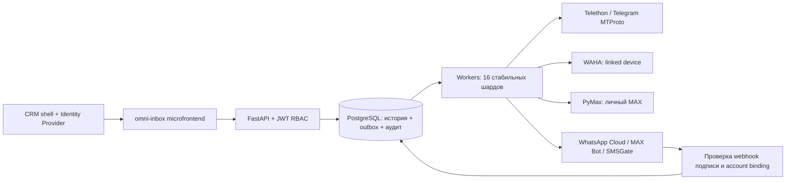

# Архитектура и 300 сотрудников

Дата: 14.10.2026. Цель — корпоративная индивидуальная переписка из собственной CRM. 300 сотрудников не тождественны 300 сессиям: по Telegram + WhatsApp + MAX на человека дают до 900 постоянных подключений, дополнительно SMS-устройства и подключения API.

## Границы модулей

- **CRM** владеет сотрудниками, корпоративными аккаунтами и выдаёт JWT. Этот сервис не создаёт отдельный каталог паролей сотрудников.
- **Микрофронтенд** выбирает аккаунт отправителя, показывает историю/очередь, выполняет пошаговый вход. Токен хранится в памяти, session-ключи провайдера в браузер не выдаются.
- **API** проверяет tenant + owner/admin, валидирует запрос и атомарно сохраняет исходящее сообщение. JWT на клиенте не заменяет проверки каждого объекта на сервере.
- **Воркеры** единолично владеют шардом аккаунтов, ведут сессии, авторизацию, чтение истории и outbox. Порядок исходящих одного аккаунта сохраняется; throttling/explicit FloodWait не обходятся.
- **PostgreSQL** — источник истины для истории, очереди, состояния курсоров и аудита. Очередь в таблице осознанно не требует Redis для первоначального масштаба.
- **Провайдеры** имеют независимые правила личности отправителя, первых сообщений, истории и ограничений скорости. Общий UI не делает правила одинаковыми.

## Устойчивость и спорные результаты

Смена владельца аккаунта не меняет его ID/историю. Подключение по телефону, username и platform ID связывается только по подтверждённому ответу провайдера. При обнаружении двух уже существующих историй они не уничтожаются автоматическим merge.

Отправка: `queued → sending → sent → delivered → read`. `sent` означает принятие провайдером, не прочтение клиентом. Сбой до известного результата даёт `uncertain`. Автоматически повторяется только явный отказ, допускающий retry; истёкшие сессии требуют нового входа. Сообщения `failed/uncertain` оператор сверяет с историей; общего «повторить любой ценой» нет.

Входящие: adapter получает event → account row lock → dedupe/receipt reconciliation → история и зашифрованный cursor/config в одной транзакции. При rollback адаптер пересоздаётся из сохранённого состояния. Повтор безопасен в рамках ключа account/conversation/provider ID.

Владение: session advisory lock выбирает владельца shard. При takeover новый процесс меняет epoch в `shard_leases`; каждая изменяющая транзакция блокирует эту строку и сверяет epoch. Старый процесс не может записать поверх нового. Соединение для advisory lock одно на worker, а не на каждый аккаунт. Нельзя использовать transaction-pooling PgBouncer для этого соединения. Изменение числа шардов требует остановки/дренирования старой конфигурации.

## Начальный расчёт, не обещание ёмкости

Для планирования пилота: 300 пользователей, 3 постоянных messenger account на человека, 100 исходящих/человек/день дают 30 000 исходящих/день. Входящие, статусы, native app echoes и импорт истории увеличивают число событий. Среднее почти ничего не говорит о всплеске в начале смены и reconnect storm.

Начальная гипотеза для измерений: 2 API-реплики, 2–4 worker-процесса с явным распределением 16 шардов, PostgreSQL на отдельном узле с SSD и backup/WAL, отдельные WAHA-узлы. Это архитектурная отправная точка, а не доказанное число CPU/RAM. WAHA/PyMax память и скорость протоколов измеряются на реальных аккаунтах. Один узел Compose не обеспечивает HA и сам по себе не даёт production SLA.

Default worker захватывает все доступные shards; добавление реплик не перераспределяет уже захваченные. Для 2 процессов задайте `0..7` и `8..15`; для HA реплики допускается запускать с перекрывающимися наборами, проверив стратегию takeover. Для множества WAHA узлов потребуется явная маршрутизация account→gateway: текущий `WAHA_URL` общий на deployment. Автоматический autoscaling/session placement не реализован.

## Что измерять перед расширением

1. 5–10 корпоративных аккаунтов каждого нужного personal-канала: login/2FA, первый контакт, native app echo, старые сообщения, перезапуск, revoke.
2. 30–50 менеджеров: несколько суток, импорт существующих чатов, ограничения частоты, reconnect после потери сети, сохранение истории при смене владельца.
3. Нагрузочный этап: 300 одновременных UI-пользователей **и отдельно** целевое число реальных sessions, всплески сообщений и восстановление после сбоя. Синтетический demo-тест проверяет только API/БД/worker.
4. Принять SLO: например p95 локального enqueue <500 мс при согласованном профиле, p95 новой входящей синхронизации <5 с для поддерживаемого push-канала, отсутствие потерь подтверждённых записей, фиксированные RPO/RTO. Это целевые критерии, не результаты текущей реализации.

Polling WAHA/MAX по 10 чатов за проход имеет задержку, растущую с количеством чатов: 1000 чатов при интервале 3 с могут обходиться минуты. Для строгого SLO нужны durable push/webhooks и фоновая reconciliation; в текущей реализации polling имеет приоритет полноты доступной истории. Telegram использует MTProto difference. API frontend обновляет данные раз в 3 с; WebSocket/SSE пока не добавлены.

## Оставшаяся интеграция

Общий customer ID и привязка к сделке/карточке CRM ещё не реализованы: сейчас история на уровне account+peer. При интеграции добавьте явную таблицу подтверждённых contact endpoints и внешний customer_id, не склеивайте автоматически одинаковые имена. Служебные заметки, команды/очереди, SLA routing и supervisor UI — следующий продуктовый слой. Audit содержит управляющие действия без сообщений; retention/deletion/export требуют политики компании и обслуживающих задач.

Для промышленной эксплуатации необходимы метрики/алерты по возрасту outbox, uncertain/fail, session state, last successful sync, webhook rejects, DB pool/lock latency и backup restore; текущий пакет содержит healthchecks и безопасные журналы, но не готовый Prometheus/Grafana-контур. Развёртывание TLS, IAM, ключевая ротация, HTTP rate limiting на ingress, длительная soak-проверка, media pipeline/антивирус и dependency/SBOM-аудит остаются явными этапами приёмки.
